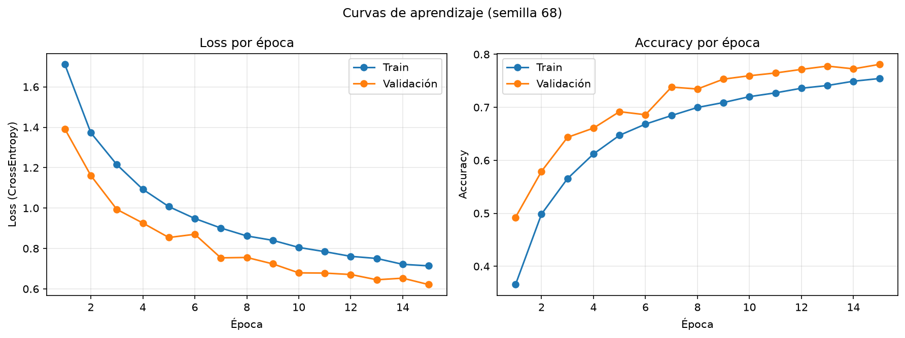
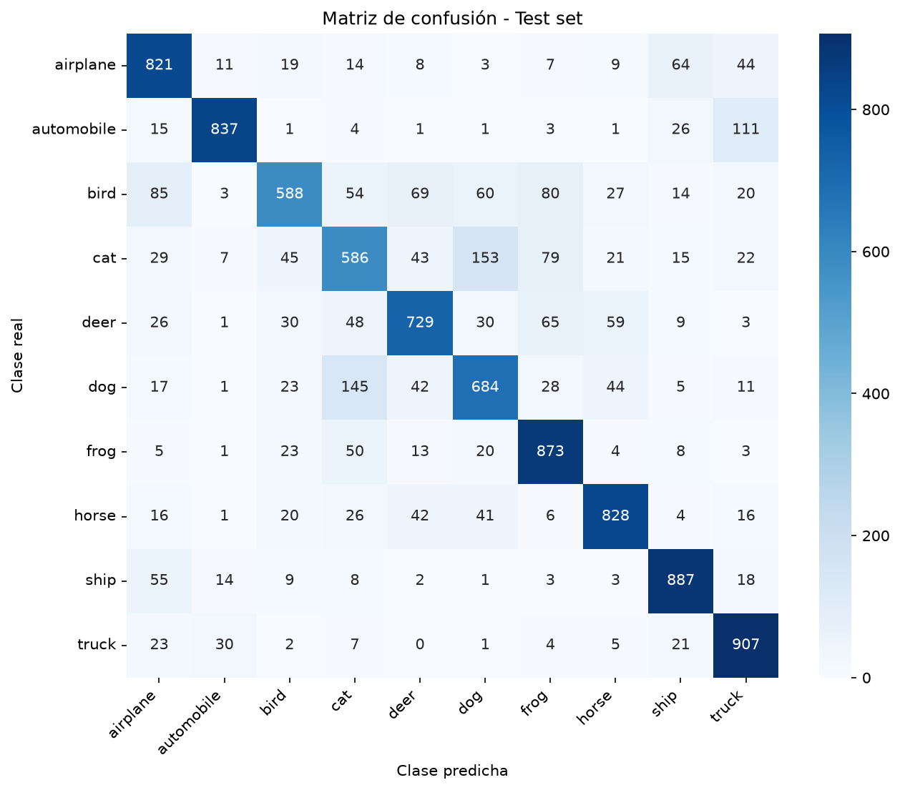
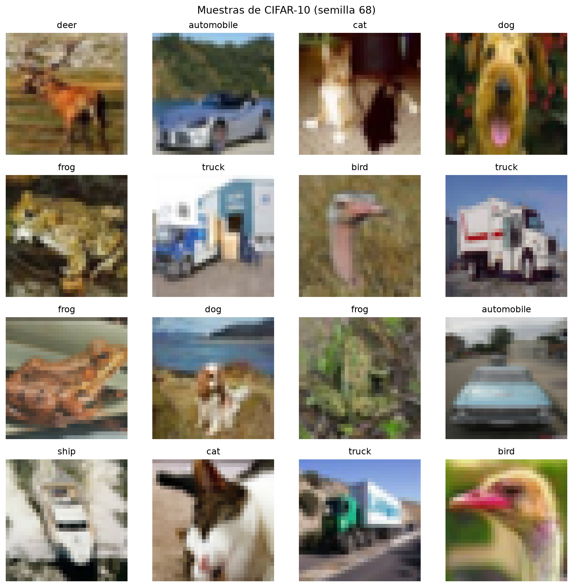

# Clasificación de imágenes CIFAR-10 mediante CNN (PyTorch)

**Evaluación de la Segunda Unidad – Inteligencia Artificial**
Universidad Andina del Cusco – Escuela Profesional de Ingeniería de Sistemas

- **Estudiante:** Rodrigo Armando Oviedo Vargas
- **Código de matrícula:** 022101068E
- **Semilla individual:** `68` (dos últimos dígitos del código) aplicada con `torch.manual_seed(68)` y `np.random.seed(68)`

---

## 1. Estructura del repositorio

```
cnn-cifar10/
├── src/
│   ├── dataset.py      # Carga, semilla, transformaciones, partición estratificada y visualización (Pregunta 1)
│   ├── model.py        # Arquitectura CNN y validación de shapes (Pregunta 3)
│   └── train.py        # Bucle de entrenamiento, métricas y gráficas (Pregunta 4)
├── notebooks/
│   └── experiment.ipynb  # EDA, visualización de muestras y pruebas
├── outputs/
│   ├── sample_grid.png       # Cuadrícula de 16 imágenes con su etiqueta real
│   ├── loss_accuracy.png     # Curvas de aprendizaje
│   └── confusion_matrix.png  # Matriz de confusión sobre el set de test
├── requirements.txt
└── README.md
```

## 2. Cómo ejecutar

```bash
pip install -r requirements.txt
python src/dataset.py     # descarga CIFAR-10, guarda la cuadrícula y muestra la partición
python src/model.py       # valida los shapes del forward pass
python src/train.py       # entrena, evalúa y guarda las gráficas en outputs/
```

## 3. Pipeline de datos (Pregunta 1)

| Aspecto | Decisión |
|---|---|
| Dataset | CIFAR-10 (60 000 imágenes RGB de 32×32, 10 clases) vía `torchvision.datasets.CIFAR10` |
| Partición | 50 000 de train → **45 000 train / 5 000 validación** (estratificada con `train_test_split(stratify=...)`, `random_state=68`); 10 000 de test |
| Normalización | `Normalize` con media y desviación estándar por canal RGB de CIFAR-10 |
| Data Augmentation (solo train) | `RandomCrop(32, padding=4)` y `RandomHorizontalFlip(p=0.5)` |
| Validación / Test | Sin augmentation, únicamente `ToTensor` + `Normalize` |

## 4. Justificación teórica: CNN frente a MLP (Pregunta 2)

### 4.1 Limitaciones de un Perceptrón Multicapa (MLP) con imágenes

Un MLP exige que la entrada sea un vector unidimensional. Una imagen de CIFAR-10 tiene forma 3×32×32, por lo que debe aplanarse en un vector de 3 072 valores, lo cual genera tres problemas:

1. **Explosión de parámetros.** Una sola capa oculta de 1 024 neuronas requiere 3 072 × 1 024 + 1 024 ≈ **3,1 millones de parámetros**, cinco veces más que toda la CNN propuesta (≈ 0,62 millones). Con imágenes de mayor resolución el crecimiento es inviable, con el consecuente riesgo de sobreajuste y alto costo computacional.
2. **Pérdida de la estructura espacial.** Al aplanar, píxeles vecinos y píxeles lejanos se tratan igual; el MLP no sabe qué píxeles están cerca entre sí y debe aprender esa relación desde cero.
3. **Ausencia de invarianza a la posición.** Si un objeto se desplaza unos píxeles, el vector de entrada cambia por completo y las neuronas que detectaban el patrón en otra posición ya no responden. El MLP tendría que aprender el mismo patrón por separado en cada posición posible.

### 4.2 Propiedades de las CNN que resuelven estas limitaciones

- **Conexiones locales (campo receptivo local):** cada neurona de una capa convolucional solo observa una región pequeña (por ejemplo 3×3 píxeles), aprovechando que en las imágenes la información relevante (bordes, texturas) es local.
- **Weight Sharing (pesos compartidos):** el mismo filtro (kernel) se desliza sobre toda la imagen, reutilizando sus pesos en cada posición. Por ejemplo, `Conv2d(3→32, kernel 3×3)` tiene solo 3×3×3×32 + 32 = **896 parámetros**, independientemente del tamaño de la imagen.
- **Invarianza/equivarianza espacial:** como el mismo filtro se aplica en todas las posiciones, un patrón se detecta sin importar dónde aparezca; además, `MaxPool2d` aporta tolerancia a pequeños desplazamientos y reduce la resolución progresivamente.
- **Jerarquía de características:** las primeras capas detectan bordes y colores, las intermedias texturas y formas, y las últimas partes de objetos, que las capas densas finales combinan para clasificar.

## 5. Arquitectura de la CNN (Pregunta 2.2 y 3)

Tres bloques convolucionales (`Conv2d` → `ReLU` → `MaxPool2d`) seguidos de un clasificador denso. Formato de tensores: `(Batch, Channels, Height, Width)`.

| # | Capa | Configuración | Shape de salida | Parámetros |
|---|---|---|---|---|
| – | Entrada | imagen normalizada | (B, 3, 32, 32) | – |
| 1 | Conv2d + ReLU | 3 → 32, kernel 3×3, padding 1 | (B, 32, 32, 32) | 896 |
| 1 | MaxPool2d | 2×2 | (B, 32, 16, 16) | 0 |
| 2 | Conv2d + ReLU | 32 → 64, kernel 3×3, padding 1 | (B, 64, 16, 16) | 18 496 |
| 2 | MaxPool2d | 2×2 | (B, 64, 8, 8) | 0 |
| 3 | Conv2d + ReLU | 64 → 128, kernel 3×3, padding 1 | (B, 128, 8, 8) | 73 856 |
| 3 | MaxPool2d | 2×2 | (B, 128, 4, 4) | 0 |
| – | Flatten | 128 × 4 × 4 | (B, 2048) | 0 |
| 4 | Linear + ReLU | 2048 → 256 | (B, 256) | 524 544 |
| – | Dropout | p = 0,5 | (B, 256) | 0 |
| 5 | Linear (salida) | 256 → 10 | (B, 10) | 2 570 |
| | | **Total** | | **620 362** |

**Hiperparámetros:** función de pérdida `CrossEntropyLoss`, optimizador `Adam` (lr = 1e-3), batch size = 128, épocas = 15, semilla = 68.

## 6. Resultados (Pregunta 4)

Resultados obtenidos al ejecutar `python src/train.py` en CPU (semilla 68, 15 épocas, batch 128, Adam con lr = 1e-3, aprox. 200 s por época):

| Métrica | Valor |
|---|---|
| Train accuracy (época 15) | 0,7543 |
| Validación accuracy (época 15) | 0,7810 |
| Mejor validación accuracy | 0,7810 (época 15) |
| Train loss (época 15) | 0,7141 |
| Validación loss (época 15) | 0,6212 |
| **Test accuracy** | **0,7740** |
| **Test loss** | **0,6471** |
| Brecha train − validación (accuracy) | −0,0267 |

**Evolución del entrenamiento:**

| Época | Train loss | Train acc | Val loss | Val acc |
|---|---|---|---|---|
| 1 | 1,7112 | 0,3655 | 1,3920 | 0,4924 |
| 5 | 1,0073 | 0,6472 | 0,8543 | 0,6918 |
| 10 | 0,8052 | 0,7201 | 0,6794 | 0,7596 |
| 15 | 0,7141 | 0,7543 | 0,6212 | 0,7810 |

**Métricas por clase (test, 1 000 imágenes por clase):**

| Clase | Precision | Recall | F1-score |
|---|---|---|---|
| airplane | 0,752 | 0,821 | 0,785 |
| automobile | 0,924 | 0,837 | 0,878 |
| bird | 0,774 | 0,588 | 0,668 |
| cat | 0,622 | 0,586 | 0,604 |
| deer | 0,768 | 0,729 | 0,748 |
| dog | 0,688 | 0,684 | 0,686 |
| frog | 0,760 | 0,873 | 0,813 |
| horse | 0,827 | 0,828 | 0,828 |
| ship | 0,842 | 0,887 | 0,864 |
| truck | 0,785 | 0,907 | 0,842 |
| **Promedio macro** | 0,774 | 0,774 | 0,772 |

**Curvas de aprendizaje:**



**Matriz de confusión (test):**



**Muestras del dataset:**



## 7. Análisis crítico (Pregunta 4.4)

### 7.1 Diagnóstico: no hay overfitting

Con la semilla 68, el modelo **no muestra síntomas de sobreajuste**, por tres evidencias cuantitativas:

1. **La brecha train − validación es negativa (−2,67 puntos porcentuales).** En overfitting la brecha es positiva y crece con las épocas (el train mejora y la validación se estanca). Aquí la validación (78,10 %) supera al train (75,43 %).
2. **El loss de validación baja de forma sostenida**, de 1,3920 a 0,6212 (−55 %), junto con el de train (1,7112 a 0,7141). Solo hay oscilaciones menores (menos de 0,02) en las épocas 6, 8 y 14, y ninguna tendencia al alza. Además, el mínimo de val loss se alcanza en la última época.
3. **El test accuracy (77,40 %) es casi idéntico al de validación (78,10 %)**: solo 0,70 puntos de diferencia. El modelo generaliza a datos nunca vistos en la misma medida que a la validación.

**¿Por qué la validación supera al train?** Porque las métricas de train se acumulan durante la época mientras los pesos aún mejoran, con `Dropout(0,5)` activo y con Data Augmentation (`RandomCrop` + `RandomHorizontalFlip`), que hace más difíciles las imágenes de entrenamiento. La validación se mide al final de cada época, con el modelo en `eval()` (sin Dropout) y sin augmentation. Es un comportamiento esperado con regularización fuerte, no un error.

### 7.2 Underfitting leve: el modelo aún no converge

El train accuracy final (75,43 %) es moderado y las curvas **siguen mejorando al terminar la época 15**: la validación alcanza su mejor valor justo en la última época (0,7810) y no hay meseta. Esto indica un **subajuste leve por falta de entrenamiento** (más que por falta de capacidad): el modelo aún tiene margen para aprender. Por tanto, el diagnóstico global es un **ajuste razonable, sin sobreajuste y con margen de mejora**.

### 7.3 Análisis por clase

- **Mejor desempeño:** *automobile* (F1 = 0,878, precision 0,924), *ship* (0,864) y *truck* (0,842). Son objetos con formas rígidas y distintivas.
- **Peor desempeño:** *cat* (F1 = 0,604), *bird* (0,668, recall de solo 0,588) y *dog* (0,686). Son animales con texturas, colores y fondos parecidos entre sí, lo que provoca que muchas de sus imágenes caigan fuera de la diagonal de la matriz de confusión (por ejemplo, el 41,4 % de los gatos no es reconocido como gato).

### 7.4 Mejoras propuestas

- Entrenar más épocas (30 a 50) y conservar el mejor modelo según la validación, ya implementado con `best_model.pt`.
- Añadir `BatchNorm2d` tras cada convolución para acelerar y estabilizar la convergencia.
- Usar un *scheduler* de tasa de aprendizaje (por ejemplo `StepLR` o `CosineAnnealingLR`).
- Ampliar la capacidad con bloques convolucionales dobles (dos `Conv2d` antes de cada `MaxPool2d`).
- Entrenar en GPU para reducir el tiempo (en CPU cada época tardó unos 200 s).
